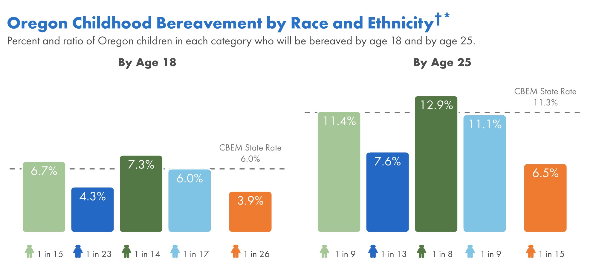

# Agenda

1. Housekeeping

1. CBEM data viz live coding

1. Making functions for data viz

1. Next week

::: {.notes}
https://rin3fall2026.rfortherestofus.com/slides/slides-week-09.html
:::

# Housekeeping

[Check-in survey](https://forms.gle/Fvz9H4oQUGFozeN66)

# Housekeeping

. . .

Remaining weeks:

- Week 10: Catch-up week (possible AI session)

- Week 11: Advanced data viz, part 2 (making your own ggplot theme)

- Week 12: Advanced Quarto

- Week 13: Final projects

# AI Session Next Week (?) {.inverse}

# Housekeeping

- You can get feedback from your coach through the end of December
- You have access to materials FOREVER!

# Advanced Data Viz {.inverse}

::: {.notes}
This week you learned about:

- Reordering
- Using color to highlight findings
- Adding descriptive labels
- Using annotations
:::

## Assessment break



::: {.small}
How would you improve this chart? Name as many fixes as you can.

```{r}
#| echo: false
library(ggplot2)

coffee <- tibble::tibble(
  drink = c("Latte", "Espresso", "Cappuccino", "Mocha", "Americano", "Tea"),
  n     = c(120, 45, 90, 30, 75, 20)
)

ggplot(coffee, aes(x = drink, y = n, fill = drink)) +
  geom_col(color = "black") +
  labs(title = "Plot") +
  theme_gray() +
  theme(
    axis.text.x      = element_text(angle = 90),
    panel.grid.minor = element_line(color = "grey40"),
    panel.grid.major = element_line(color = "grey30")
  )
```
:::

## Assessment break

::: {.small}
Some possible improvements:

- **Reorder** the bars by sales with `fct_reorder()`, or flip to horizontal bars.
- **Use color strategically**: drop the rainbow fill and highlight one bar (e.g., Latte).
- **Declutter**: remove the legend, dark gridlines and grey background; no need for rotated labels once the bars are horizontal.
- **Label descriptively**: replace `n` and `drink` with meaningful axis labels.
- **Title the finding**: e.g., "Lattes outsell every other drink", aligned to the plot edge.
:::

# CBEM Bar Chart Live Coding

[](https://cbem.judishouse.org/cbem-reports)

::: {.notes}
- chicklet
- colors
- order of bars
- limits (hispanic on end at 5.5)
- text labels
- state rate line and text
- patchwork to stitch together plots
- make function
:::


# Next Week

- Catch-up week

- Week 11 is more advanced data viz, including making your own custom theme

